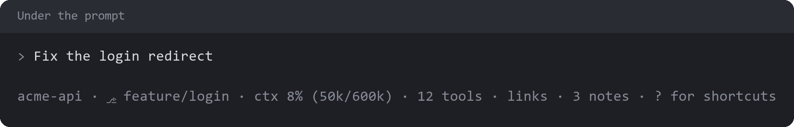

# claude-mods

Claude Code mods that add panes, status items and guardrails to the terminal interface. Each mod works alone, and they link up when installed together: the `project-status` row opens the panes the other mods own.



| Mod | Adds | Commands |
| --- | --- | --- |
| [project-status](project-status/README.md) | A clickable status row you can configure | `/statusbar` |
| [worktrees](worktrees/README.md) | Inspect, merge and clean up a repo's worktrees | `/worktrees` |
| [project-notes](project-notes/README.md) | Notes and pictures kept with a repo, unsent until you use them | `/notes` |
| [session-files](session-files/README.md) | Files and tools used this session, plus links and commands Claude leaves for you | `/files`, `/links` |
| [context-breakdown](context-breakdown/README.md) | Context window and plan usage, with a link to the session and its job folder | `/ctx` |
| [repo-dashboard](repo-dashboard/README.md) | Git status of every repo beside the current project | `/repos` |
| [project-artifacts](project-artifacts/README.md) | Your claude.ai artifacts under the repos they belong to, with open comments | `/repo-artifacts` |
| [code-guardrails](code-guardrails/README.md) | Tells Claude when a file grows too long or a comment narrates history | None |

The pictures are illustrations with made-up data, drawn by `tools/render_images.py`. The real panes follow your terminal's theme.

## Install

From a shell, add this repo as a marketplace, then install the mods you want:

```sh
claude plugin marketplace add nrc4867/claude-mods
claude plugin install project-status@local-mods
claude plugin install worktrees@local-mods
claude plugin install project-notes@local-mods
claude plugin install session-files@local-mods
claude plugin install context-breakdown@local-mods
claude plugin install repo-dashboard@local-mods
claude plugin install project-artifacts@local-mods
claude plugin install code-guardrails@local-mods
```

To work on the mods, clone this repo and add your clone as the marketplace instead, by its full path. The mods are then read from that folder, so after an edit you run `/reload-plugins` in the session.

To load a mod from a clone with no install, and have every save reload it, name its folder when you start Claude Code:

```sh
claude --plugin-dir ./project-status
```

Don't use both ways for the same mod at once.

## Develop

Run these from this folder:

```sh
claude plugin validate project-status
claude plugin test project-status
npx --yes -p typescript tsc -p project-status
```

The engine writes each mod's `.claude-plugin/types/` when it loads the mod, and git ignores that folder. A type check needs the mod to have loaded once.

To redraw the pictures, on Windows only because of its fonts, with Pillow installed:

```sh
python tools/render_images.py
```

## Platform

The mods are developed and run on Windows, and written to work on macOS too. So far the macOS paths have only run against simulated commands, so tell me what breaks if you try them there. `session-files` and `project-notes` name what differs in their READMEs.

## License

[Apache License 2.0](LICENSE). Copyright 2026 Nicholas Chieppa.
