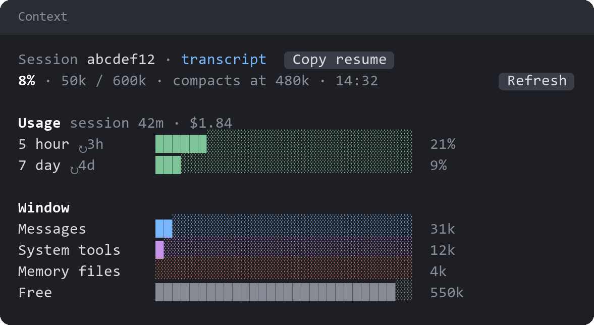

# context-breakdown

`/ctx` opens a pane showing what fills the context window and how much of your plan you've used. It refreshes each turn.

- **Session:** the session's id, a link to its transcript, and a button that copies the resume command. Background sessions also link to their job folder under `~/.claude/jobs/`.
- **Usage:** session length, cost and plan limits, with when each limit resets. On a plan with a monthly spend limit, such as Enterprise, a **Monthly spend** bar shows what you've spent against it.
- **Window:** tokens by category, then by memory file and MCP server.

The window figures fill in after the first response.

The monthly spend comes from the same report as `/usage`. Claude Code doesn't pass it to mods, so the pane asks a headless `claude -p` for it, which makes no model request and saves no session. It asks when the pane opens, at most every 5 minutes after that, and whenever you press Refresh.

## License

[Apache License 2.0](LICENSE).
