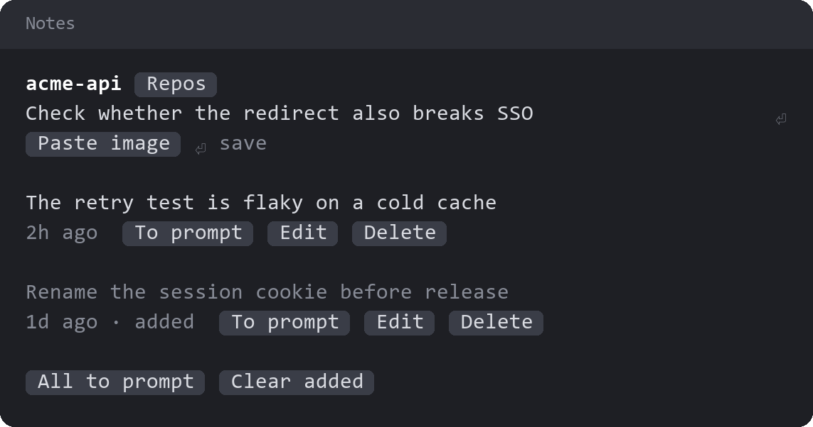

# project-notes

`/notes` keeps notes on a repo for later. Claude doesn't see them until you put one in your prompt.

- **Writing:** type a note and press Enter. `/notes` also works while Claude is mid-turn.
- **Images:** copy a picture and press `Paste image`, as many times as you like. Pictures wait under the field and save with the note on Enter or `Save note`.
- **Using a note:** `To prompt` adds it to your prompt box without sending it. Pictures go in as file paths, because a mod can only put text in the prompt box.
- **Removing:** `Delete` and `Clear added` take a second press. Deleting a note also deletes its pictures.

Notes live in `claude-project-notes.json` and `claude-project-notes-images/` inside the repo's shared git folder, usually `.git/`. So:

- All of a repo's worktrees and sessions share the same notes.
- Git never tracks them, and they don't come with a clone.
- Deleting the repo deletes them.
- They aren't private: Claude could open the files if asked to.

A session outside a repo lists the repos in its folder, and remembers your pick for the next session started there.

With `project-status` installed, the status row shows how many notes are waiting, and pressing it opens the pane.

## Platform

`Paste image`, `Open image` and removing pictures run `powershell.exe`, so they need Windows. Pictures are drawn only in the terminal, and only if it can show images. The mobile app has no text fields, so there you can read and send notes but not write or edit them.

## License

[Apache License 2.0](LICENSE).
