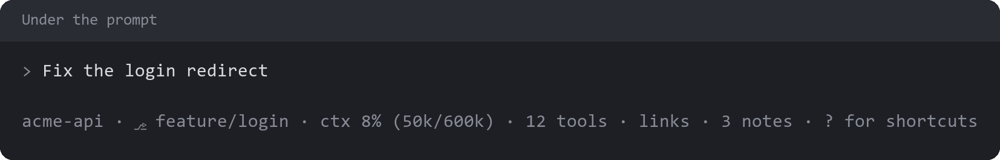

# project-status

A clickable status row you can configure.

## Status row



The row under the prompt shows the project, branch, context fill, tool calls this session, links and waiting notes. Pressing an item opens its pane:

| Item | Opens | From |
| --- | --- | --- |
| Project | Repos | `repo-dashboard` |
| Branch | Worktrees | `worktrees` |
| Context | Context | `context-breakdown` |
| Tools | Session activity | `session-files` |
| Links | Links | `session-files` |
| Notes | Notes | `project-notes` |

An item only appears, on the bar and in `/statusbar`, while the mod that answers it is installed, so with `project-status` alone the row holds only commands you added. Your order and hidden choices are kept, and an item comes back when its mod does.

### Choosing what the bar shows

`/statusbar` lets you reorder and hide items, and add any slash command with a title. Your choices are kept across `/clear`, sessions and repos.

Pressing a command item runs the command as if you typed it, so it waits until Claude is idle and its output lands in the transcript, where Claude can read it. Only commands the session knows can be added, and an added command's mod has to be loaded for the press to work.

### Showing live information from your own mod

A command item shows its title until its mod publishes something. To publish, write a `$.state` value named `statusBar`, keyed by command name:

```ts
const statusBar = { plugin: 'my-mod', key: 'statusBar' } as const

await $.state.set(statusBar, {
  deploy: { text: '2 running', color: 'warning' },
})
```

- **`text`** replaces the title. It's limited to one line of 40 characters.
- **`color`** is optional: `success`, `warning`, `error` or `suggestion`. Without it, the item is dim like the others.
- Declare `statusBar` in your mod's contract, as with any `$.state` value.
- Each write replaces everything your mod published. Writing `{}` puts the titles back.
- Published text lasts for the session, so write it again at `session.start` if it should show from the start.

`session-files` publishes its link count and `project-notes` its count of waiting notes this way.

## License

[Apache License 2.0](LICENSE).
