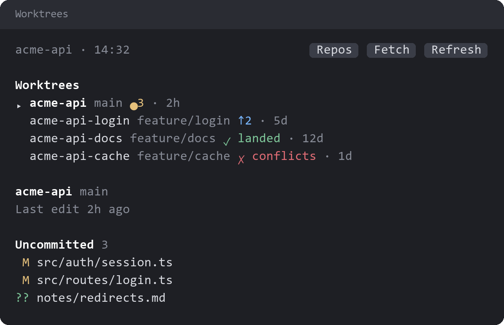
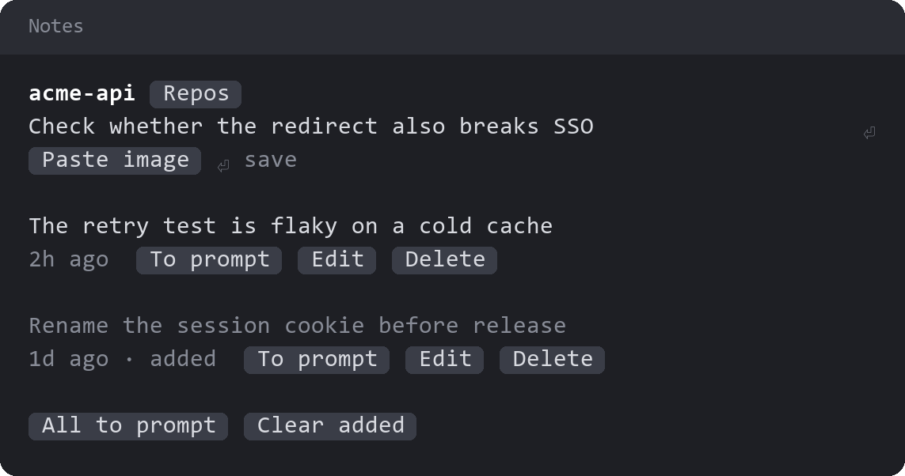

# project-status

A clickable status row, a pane for managing a repo's worktrees, and notes that stay with a repo.

## Status row

The row under the prompt shows the project, branch, context fill, tool calls this session, links and waiting notes. Pressing an item opens its pane:

| Item | Opens | From |
| --- | --- | --- |
| Project | Repos | `repo-dashboard` |
| Branch | Worktrees | This mod |
| Context | Context | `context-breakdown` |
| Tools | Session activity | `session-files` |
| Links | Links | `session-files` |
| Notes | Notes | This mod |

An item whose mod isn't installed still shows, but pressing it does nothing.

## Worktrees

`/worktrees` lists the repo's worktrees and other local branches.

- **Each row** shows uncommitted files (`●3`), commits ahead and behind (`↑2 ↓1`), whether the work has landed on the base branch, merge conflicts, and the age of the last activity.
- **Last activity** is the newer of the latest commit and the newest uncommitted file. Only the first 200 uncommitted files are checked.
- **Selecting a worktree** lists its changed files. Pressing a file shows its diff.
- **Merging** fast-forwards the base branch when it can. A merge that needs a rebase asks for a second press first.
- **Safe cleanup** removes a landed worktree and its branch after a second press. It never forces the removal and never touches the main worktree.
- **Conflicts** get an `Add to prompt` button that puts a request to resolve them in your prompt box, unsent.

## Notes

`/notes` keeps notes on a repo for later. Claude doesn't see them until you put one in your prompt.

- **Writing:** type a note and press Enter. `/notes` also works while Claude is mid-turn.
- **Images:** copy a picture and press `Paste image`, as many times as you like. Pictures wait under the field and save with the note on Enter or `Save note`.
- **Using a note:** `To prompt` adds it to your prompt box without sending it. Pictures go in as file paths, because a mod can only put text in the prompt box.
- **Removing:** `Delete` and `Clear added` take a second press. Deleting a note also deletes its pictures.

Notes live in `claude-project-notes.json` and `claude-project-notes-images/` inside the repo's shared git folder, usually `.git/`. So:

- All of a repo's worktrees and sessions share the same notes.
- Git never tracks them, and they don't come with a clone.
- Deleting the repo deletes them.
- They aren't private: Claude could open the files if asked to.

A session outside a repo lists the repos in its folder, and remembers your pick for the next session started there.

## Platform

`Paste image`, `Open image` and removing pictures run `powershell.exe`, so they need Windows. Pictures are drawn only in the terminal, and only if it can show images. The mobile app has no text fields, so there you can read and send notes but not write or edit them.

## License

[Apache License 2.0](LICENSE).
