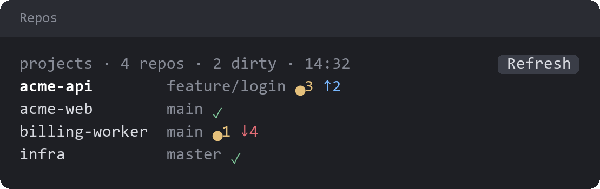

# repo-dashboard

A pane showing the git status of every repo beside the current project. It refreshes each turn and after git commands.

Each row shows the branch, uncommitted changes (`●3`), commits ahead and behind (`↑2 ↓4`), or `✓` when the repo is clean.

The pane scans the session root's child folders, or its sibling folders when the root is itself a repo.

With `project-status` installed, pressing a repo opens its Worktrees pane, and pressing the project item in the status row opens this pane.

## License

[Apache License 2.0](LICENSE).
