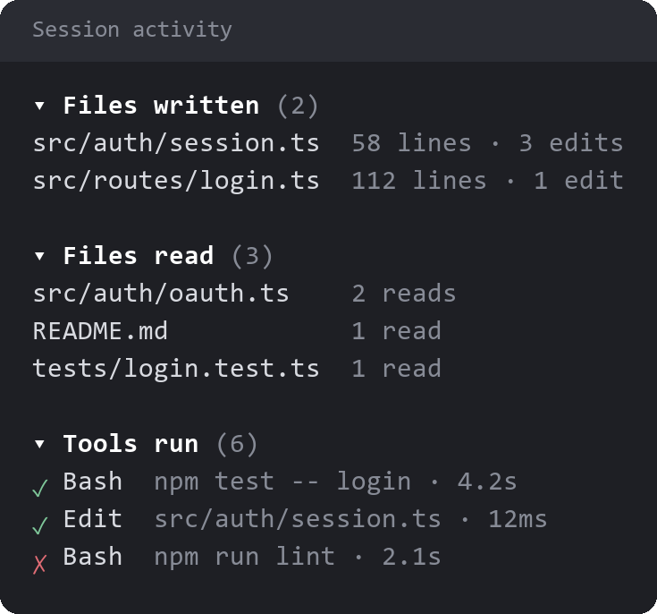
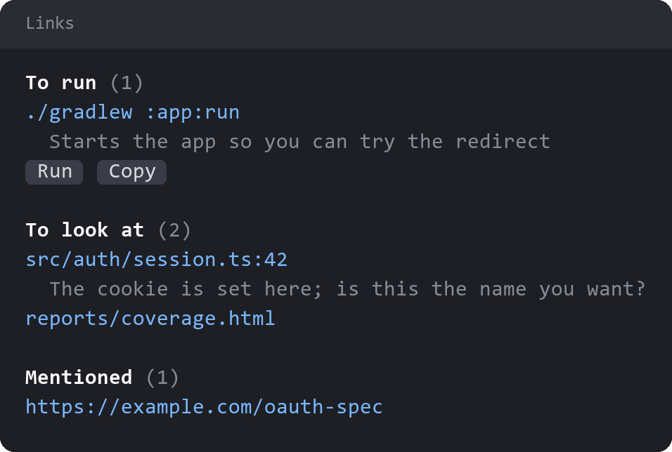

# session-files

Two panes for the current session: what Claude has touched, and what it wants you to look at or run.

## Session activity

`/files` lists the files written, the files read and the tools run this session. Pressing a file opens it in your editor.

## Links

`/links` collects what Claude has pointed you to.

- **To run:** commands Claude attached with its `command_for_user` tool.
- **To look at:** files and URLs Claude flagged with its `link_for_user` tool, each with a line on why.
- **Mentioned:** files and URLs named in Claude's replies, picked up automatically.

### Running a command

A command runs only when you press `Run`, then `Confirm run`. It runs in bash under your own account, **outside Claude Code's permission checks**, so read it before you confirm. Commands holding hidden characters are refused.

The row shows the last 15 lines of output, with `Stop`, `Copy` and `Copy output`. Claude doesn't see the result unless you share it.

## Platform

- Files open with IntelliJ's `idea` command, which needs to be on your `PATH`.
- Commands run with Git Bash on Windows.
- On Windows, `Stop` may not end processes the command started.

## License

[Apache License 2.0](LICENSE).
