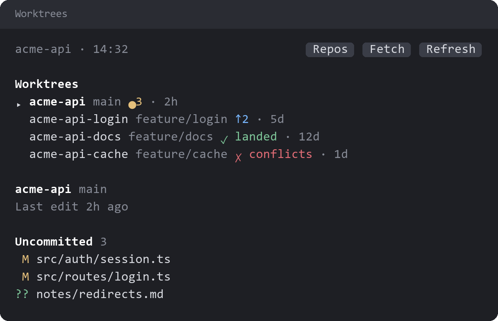

# worktrees

A pane for managing a repo's worktrees. With `project-status` installed, pressing the branch in the status row opens it. With `repo-dashboard` installed, pressing a repo there opens it on that repo.

`/worktrees` lists the repo's worktrees and other local branches.

- **Each row** shows uncommitted files (`●3`), commits ahead and behind (`↑2 ↓1`), whether the work has landed on the base branch, merge conflicts, and the age of the last activity.
- **Landed** means the commits are on the base branch and nothing is left uncommitted. A worktree whose commits landed but which still has uncommitted files shows a warning instead (`! uncommitted`), because that work exists only there.
- **Last activity** is the newer of the latest commit and the newest uncommitted file. Only the first 200 uncommitted files are checked.
- **Selecting a worktree** lists its changed files. Pressing a file shows its diff.
- **Merging** fast-forwards the base branch when it can. A merge that needs a rebase asks for a second press first.
- **Safe cleanup** removes a landed worktree and its branch after a second press. It never forces the removal and never touches the main worktree.
- **Conflicts** get an `Add to prompt` button that puts a request to resolve them in your prompt box, unsent.

## License

[Apache License 2.0](LICENSE).
